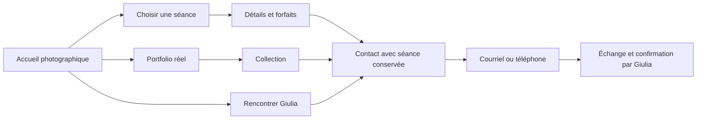

# Atelier Giulia — blueprint de refonte

Proposition du 2 novembre 2026. Aucune modification de l'application ou de la production dans cette phase. [Audit](01-audit.md) · [Système visuel](02-design-system.md) · [Feuille de route](04-implementation-roadmap.md).

## Objectif et périmètre

Permettre à un visiteur de comprendre rapidement le style de Giulia, de vérifier que son projet et sa région correspondent, de consulter une offre claire et de prendre contact avec le minimum de répétitions. Conserver les services, les tarifs approuvés, la gestion propriétaire, les galeries clients et les protections techniques.

Le parcours cible vise une **prise de contact qualifiée**, pas une réservation automatiquement confirmée. Le site ne dispose pas d'un calendrier transactionnel ni d'un paiement public ; les CTA doivent refléter cette réalité. Le nombre de demandes et de réservations actuel est inconnu.

## Architecture de l'information

### Sitemap cible compatible avec les routes actuelles

| Destination | Place et contenu recommandés | Condition |
| --- | --- | --- |
| Accueil `/fr/`, `/en/` ; alias `/` conservé | Signature photographique, offre et localisation courte, choix des séances, contact | Toujours disponible avec fallback utile |
| Choisir une séance | Sélecteur explicite dans l'accueil/menu vers les slides existantes | Disponible même lorsque `/services` est désactivée |
| Séances `/fr/services`, `/en/services` | Vue d'ensemble scannable ; fiche partagée avec l'accueil | Option à réactiver seulement si la propriétaire souhaite une page de comparaison ; réglage actuel off respecté |
| Portfolio `/fr/portfolio`, `/en/portfolio` | Collections réelles autorisées, catégories compréhensibles | Garder l'URL ; priorité dans le menu proportionnelle au contenu réellement publié |
| Collection `/fr/portfolio/:slug`, `/en/portfolio/:slug` | Série cohérente, court contexte, visionneuse, lien pertinent vers contact | Aucune dépendance à la publication d'une galerie client |
| À propos `/fr/about`, `/en/about` | Giulia, sa démarche et le déroulement de la séance | Respecter le réglage propriétaire d'activation |
| Contact `/fr/contact`, `/en/contact` ; `/contact` conservé | Actions directes, contexte de séance, région, attentes, carte volontaire | Fonctionne sans API de galerie, sans Analytics ni carte |
| Confidentialité `/fr/privacy`, `/en/privacy` | Informations exactes et gestion des choix | Accessible depuis le footer et le panneau de consentement |
| Galeries privées `/e/*` | Livraison par lien, accès et fonctions actuels | Aucun ajout dans le sitemap marketing ; aucune exposition de média protégé |

Navigation recommandée à terme : **Séances · Portfolio · À propos · Contact**, avec Contact distingué visuellement. « Séances » peut ouvrir le choix des slides plutôt qu'un lien 404. Tant que le portfolio est vide, ne pas le présenter comme la première preuve de l'expertise ; améliorer son état vide sans supprimer brutalement ses URLs. Le nom Atelier Giulia continue de ramener à l'accueil.

Le répertoire de galeries est actuellement désactivé. La refonte ne le réactive pas pour remplir l'accueil. Une page de réservation, un blog, une boutique et de nouvelles pages géographiques ne sont pas nécessaires à ce périmètre.

Le schéma décrit le parcours proposé ; il ne représente pas un système de réservation à développer.

## Accueil : enrichir la narration sans remplacer le diaporama

La home Atelier n'utilise pas les sections longues de la home Cadrora. Modifier `home.sections` ne suffirait donc pas à créer un nouveau parcours : `SessionScrollStory` pilote la présentation active. L'ordre des séances vient du catalogue propriétaire et doit rester éditable.

| Ordre / couche | Contenu proposé | Comportement |
| --- | --- | --- |
| 1. En-tête | Identité, choix des séances, portfolio utile, À propos, Contact, langue | Compact après la première slide ; pas d'avis de préparation une fois sa raison disparue |
| 2. Première séance | Titre spécifique, une phrase de bénéfice, région confirmée en contexte court, accès aux détails et contact secondaire | Conserver la photographie dominante ; fusionner les deux paragraphes d'introduction actuels |
| 3. Séances suivantes | Titre, promesse courte et accès aux forfaits | Respecter l'ordre métier de la propriétaire ; ne pas classer d'après des conversions non mesurées |
| 4. Navigation de séance permanente | Libellés accessibles et choix explicite ; points existants | Accès à n'importe quelle offre sans devoir traverser les slides |
| 5. Dernière séance / footer existant | Contact, accès à Giulia et au portfolio, confidentialité et choix | Conserver l'apparition finale et la place réservée ; ne pas ajouter un bloc qui dépasse le viewport contractuel |

Les preuves détaillées, le déroulement et les témoignages autorisés vivent d'abord dans Portfolio et À propos. Cela évite d'ajouter à chaque photographie un bloc d'informations qui réduit sa lisibilité. Un accueil traditionnel à sections pourrait être étudié ultérieurement, mais il changerait une décision explicitement approuvée ; il n'est pas le scénario recommandé ici.

À 320 × 568 : titre plus contenu, une seule phrase, action visible ou immédiatement accessible ; conserver la zone de défilement interne et son focus. À 390 × 844 : CTA visible dès le premier cadre après chargement et coexistence vérifiée avec le consentement. Ne pas résoudre ce problème en masquant des conditions commerciales ou en réduisant le texte sous une taille lisible.

## Fiche de séance et forfaits

Réorganiser `SessionDetailsModal`, sans dupliquer les champs ou créer une nouvelle source de prix :

1. Titre de la séance et bénéfice en une ou deux phrases.
2. Résumé durée/prix existants, dans une zone facile à lire ; si aucune donnée n'est approuvée, mention explicite de devis plutôt qu'un chiffre inventé.
3. Action « Parlons de votre séance », puis les forfaits.
4. Forfaits : nom, prix, durée/livrables lorsqu'ils existent dans le résumé, différences essentielles.
5. Inclus et informations pratiques, puis action finale.

Les `tariffs` actuels ont des champs `name`, `price`, `summary` : ne pas parser leurs phrases pour inventer des colonnes structurées de durée ou nombre de photos. Une comparaison en colonnes doit soit rester une présentation de ces champs, soit faire l'objet d'une extension de schéma explicitement cadrée. Éviter la répétition intégrale de tous les prix dans le résumé et dans chaque forfait, sans perdre la compatibilité avec les offres sans forfaits ou à forfait unique.

Les délais d'aperçu, volumes de photos et mentions « plus populaire » déjà présents sont des déclarations du contenu propriétaire, pas des métriques vérifiées par cet audit. Les confirmer avant de les amplifier avec des badges. Ne pas ajouter d'urgence, de disponibilité restante ou de promotion non réelle.

Le close sticky, la sémantique de dialogue, Échap, le piège et la restauration du focus restent partagés. Sur mobile, privilégier le scroll du dialogue plutôt qu'un carrousel horizontal de tarifs. Si le CTA devient sticky, lui réserver de l'espace pour qu'il ne couvre aucune condition ni le dernier élément focalisable.

## Recommandations par page

### Portfolio et collections

Priorité : préparer quelques séries réellement représentatives, avec autorisation de publication et textes FR/EN. Une collection complète vaut mieux qu'une grande quantité de photos sans contexte. Proposition éditoriale, à adapter aux images disponibles : famille, maternité, couple ou anniversaire ; aucun minimum ne justifie l'utilisation de photos privées sans accord.

Chaque collection comporte une couverture adaptée aux deux formats, un titre spécifique et un court contexte factuel. Réutiliser le catalogue et la visionneuse existants. Ajouter en fin de collection une invitation à une séance comparable ; tant qu'il n'existe pas de relation structurée collection/séance, utiliser un contact générique plutôt que déduire la correspondance d'un nom de catégorie.

Pendant la préparation : état vide honnête, accès au choix des séances et à Contact. Conserver les URLs et leurs métadonnées ; ne pas remplacer le vide par un faux portfolio. Les galeries clients ne deviennent pas des collections marketing par simple changement d'étiquette.

### À propos

Conserver le portrait actuel et la biographie personnelle. Déplacer le titre ou adapter son voile lorsqu'il recouvre une zone claire. Après le portrait : une présentation courte, une méthode concrète en trois moments et une réponse aux principales appréhensions. Réutiliser le récit propriétaire existant pour le texte ; une structure plus riche doit être traitée comme composition partagée, pas comme HTML arbitraire enregistré dans D1.

Proposition de progression : faire connaissance → être guidé pendant la séance → recevoir la galerie. Les détails de préparation, délais et modalités doivent être confirmés. Remplacer « Réserver ma séance » par une invitation au contact tant qu'aucune réservation n'est possible sur le site. Un témoignage n'est ajouté qu'avec texte original, autorisation et attribution validés.

### Contact

L'action de contact précède le texte d'ambiance et la carte. Afficher clairement courriel et téléphone avec libellés d'action, numéro mis en forme pour la lecture et URL `tel:` conservée. Le visiteur peut copier l'adresse si aucun client mail n'est configuré. Ne pas proposer un canal non confirmé, par exemple SMS/WhatsApp.

Conserver `?session=…`, valider l'identifiant et le résoudre via le catalogue public, comme aujourd'hui. Utiliser le titre localisé validé pour un objet de courriel encodé. Si le catalogue échoue ou si l'identifiant est invalide, le contact générique doit toujours fonctionner. Aucun courriel n'est envoyé par le site.

Texte d'aide : indiquer les éléments utiles à fournir — type de séance, période souhaitée, lieu envisagé, nombre de participants — sans imposer un formulaire. N'annoncer ni réponse sous 24 h, ni disponibilité, ni délai de livraison complet sans confirmation.

Nommer la région desservie, puis expliquer les déplacements. La carte volontaire devient secondaire. Fournir les coordonnées publiques de secours au build de cette instance, sans les traiter comme des secrets et sans remplacer les valeurs D1. Une chaîne vide explicitement enregistrée reste un choix de masquage ; une erreur de lecture doit utiliser les valeurs de secours.

### Privacy, footer et client existant

Raccourcir le premier panneau de confidentialité en renvoyant aux explications complètes. Conserver un refus aussi facile que l'acceptation, l'absence de chargement Analytics avant accord et la possibilité de revenir sur son choix. Ne pas présenter une amélioration UX comme une certification juridique.

Footer : identité et tagline brève, Contact, Confidentialité, Gérer mes choix ; liens de navigation utiles lorsque disponibles. Conserver l'attribution Cadrora existante. Sur Home, le footer reste sur la dernière slide ; sur les pages intérieures, fin de document classique. Si la gestion des préférences est ajoutée au menu pour faciliter son accès, réutiliser le mécanisme existant.

Les clients disposant d'un lien de galerie continuent à l'utiliser. La refonte ne modifie ni les grants, ni les mots de passe, ni les favoris/retouches, ni les téléchargements. Ne pas transformer le menu en liste de galeries privées.

## Propositions de textes FR/EN

Les textes ci-dessous sont des **brouillons éditoriaux**, pas des promesses commerciales déjà approuvées. Les variables doivent être résolues uniquement depuis une information confirmée ; ne jamais publier les crochets.

| Emplacement | FR | EN |
| --- | --- | --- |
| Positionnement court | Photographie de famille, maternité et portraits — [région confirmée]. | Family, maternity and portrait photography — [confirmed service area]. |
| Première séance, titre | Portraits et familles | Portraits & families |
| Première séance, sous-titre | Des portraits naturels, des gestes spontanés et du temps pour être vous-mêmes. | Natural portraits, spontaneous moments and time to be yourselves. |
| Navigation d'offres | Choisir une séance | Choose a session |
| Détails | Découvrir la séance et ses tarifs | Explore the session and pricing |
| Détails sans prix validé | Découvrir cette séance | Explore this session |
| Invitation de contact | Parlons de votre séance | Let’s talk about your session |
| Contact, titre | Racontez-moi votre projet. | Tell me what you have in mind. |
| Contact, aide | Indiquez la séance qui vous intéresse, votre période et le lieu envisagé. | Tell me which session interests you, your preferred timing and location. |
| Contact, actions | Écrire à Giulia · Appeler · Copier l’adresse courriel | Email Giulia · Call · Copy email address |
| Objet du courriel | Projet photo — [séance] | Photography enquiry — [session] |
| À propos, lien | Rencontrer Giulia | Meet Giulia |
| Portfolio vide provisoire | Le portfolio se prépare. Découvrez les séances ou parlez-moi de votre projet. | The portfolio is taking shape. Explore the sessions or tell me about your plans. |
| Confidentialité, résumé proposé | Votre langue et vos choix restent mémorisés sur cet appareil. Autorisez-vous la mesure des visites des pages publiques avec Google Analytics ? | Your language and preferences are saved on this device. Allow Google Analytics to measure visits to public pages? |
| Choix de confidentialité | Nécessaire seulement · Autoriser l’analyse | Necessary only · Allow analytics |

Le résumé de consentement doit avoir une variante sans Analytics configuré. La politique complète conserve l'explication des exclusions galeries/admin et les autres informations nécessaires. Ce brouillon n'autorise pas un changement silencieux des finalités.

Voix : privilégier « je » lorsque Giulia parle de son travail, « vous » pour guider le visiteur ; réserver « Atelier Giulia » à l'identité. Ne pas changer chaque « nous » mécaniquement si l'offre implique réellement une équipe. Raccourcir les longues descriptions sans retirer prix, acompte, déplacements ou inclusions.

## Contenus à préparer ou confirmer

| Besoin | Information déjà disponible | À obtenir / décision nécessaire |
| --- | --- | --- |
| Zone de service | Rive-Sud mentionnée dans les offres, carte et rayon configurés | Formulation géographique publique exacte et règles hors zone |
| Famille | Titre, photo, description et inclusions génériques | Durée, prix ou devis explicite, livrables et différence avec les autres séances |
| Portfolio | Système de collections opérationnel, aucun contenu publié observé | Sélection, droits/consentements de publication, titres et descriptions FR/EN |
| Tarifs | Quatre offres structurées | Cohérence des langues/devises, fiscalité affichée, validité des volumes/délais/conditions |
| Confiance | Biographie et portrait de Giulia | Déroulement réel, témoignages autorisés si disponibles ; aucun chiffre inventé |
| Préparation | Avis de site en préparation actif | Critère de retrait après finalisation, pas une date fictive |
| Offre entreprise | Catalogue actif, absente de Home | Maintenir non mise en avant ou rendre découvrable, selon l'intention commerciale |

Ces dépendances n'empêchent pas de préparer les composants et les maquettes ; elles empêchent de publier des faits non confirmés. Rien n'est demandé à la propriétaire pour terminer le présent audit.

## Architecture d'implémentation

| Domaine | Réutiliser / étendre | Garde-fou |
| --- | --- | --- |
| Marque | `sites/atelier-giulia/theme.css`, `site.ts`, `profile.json` | Pas de fork des pages partagées pour des changements de couleur/typo |
| Accueil | `SessionScrollStory`, `SessionStoryContent`, `VerticalStorySlider` | Ordre propriétaire, une hauteur de viewport, mouvement réduit, focus des slides |
| Navigation/SEO | `PublicLayout`, `localizedMarketingPath`, génération localisée existante | Langues/availability propriétaire, canonical et sitemap cohérents |
| Tarifs | `SessionDetailsModal`, `Modal`, `ServiceCard` et schémas existants | Compatibilité sans/avec un/plusieurs forfaits ; aucune extraction fragile depuis le texte |
| Contact | `InfoPage`, `siteProfile`, réglages publics | API optionnelle, masquage explicite distinct de l'erreur, pas de prestataire obligatoire |
| Consentement | `PrivacyConsent`, `consent`, `GoogleAnalytics` | Aucun suivi avant accord ou dans les parcours privés |
| Portfolio | `PortfolioPage`, `EditorialGalleryCard`, `ProgressivePhoto`, `PhotoViewer` | Publication D1/R2, visibilité et droits d'accès préservés |

Package principal **PB**. Les modifications du thème touchent le système partagé et le profil ; les changements éventuels de contenu administratif relèvent de **PA** ; import/publication de photos utilisent **PC/PD** existants. Aucun changement de **PE** nécessaire. Toute extension de contrat ou nouvelle dépendance doit suivre l'ADR requis ; aucune n'est nécessaire au socle proposé.

## Mesure de la réussite

Avant/après à mesurer sur une période et un volume comparables, après retrait des visites internes et avec la même politique de consentement : consultation d'une séance, passage vers Contact, clic courriel/téléphone et demandes qualifiées réellement reçues. Une hausse de clics ne démontre pas une hausse de réservations. À faible trafic, préférer observations qualitatives et tendances descriptives à un A/B test sans puissance.

Événements proposés, optionnels et soumis au consentement existant : `session_details_open` (catégorie publique), `contact_click` (email/phone et origine publique), `email_copy` (succès/échec). Ne jamais envoyer adresse courriel du visiteur, texte du message, selfie, vecteur, URL de galerie privée ou ses paramètres. La catégorie doit être un identifiant public autorisé, pas une valeur arbitraire saisie dans l'URL.

Critères d'utilisabilité à tester avec quelques visiteurs représentatifs : ils identifient le type de photographie et la région après exposition brève ; ils trouvent une offre, ses modalités et le contact sans assistance ; ils distinguent une demande de renseignements d'une réservation confirmée. Ce sont des objectifs de test, pas des résultats déjà obtenus.
