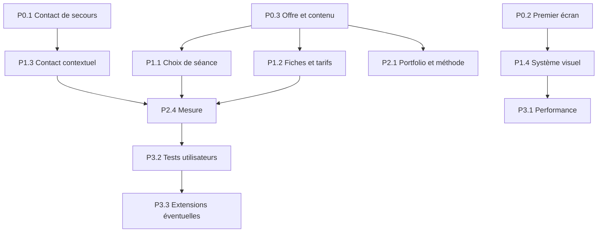

# Atelier Giulia — feuille de route de mise en œuvre

Date : 2 novembre 2026. **Backlog proposé, non exécuté.** Les quatre livrables de cette phase sont [l'audit](01-audit.md), [le système visuel](02-design-system.md), [le blueprint](03-redesign-blueprint.md) et ce document. Ils sont regroupés sous `atelier-giulia/` suivant l'accord de coordination avec l'audit Cadrora réalisé simultanément dans le même dépôt.

## Ordre recommandé et estimation

**P0 : préserver le contact et rétablir la confiance. P1 : simplifier la décision et unifier la présentation. P2 : compléter le contenu, le référencement et la mesure. P3 : optimiser sur la base des observations.**

Les priorités combinent impact et dépendances. P0 signifie « avant d'amplifier l'acquisition », pas incident de sécurité ni autorisation de déployer immédiatement. Les efforts sont indicatifs pour une personne connaissant le dépôt, hors attente de photographies, validation éditoriale et délais de publication : **S = 0,5–1 jour**, **M = 2–3 jours**, **L = 4–6 jours**. Ils ne sont pas des engagements calendaires et ne s'additionnent pas mécaniquement.

## P0 — contact, première visite et crédibilité

| Lot | Pages / constats | Livrable et périmètre | Dépendances | Effort | Critères d'acceptation |
| --- | --- | --- | --- | --- | --- |
| P0.1 — Continuité du contact | `/`, `/contact`, FR/EN ; A01 | Fournir les coordonnées publiques de fallback à l'instance et cadrer l'offre compilée de secours ; vérifier `siteProfile` et le build de déploiement | Confirmation des coordonnées publiques et des séances réellement proposées ; guide de déploiement ; PB + configuration d'instance | S–M | Dans un contexte neuf, l'échec des deux API optionnelles conserve au moins un contact réel utilisable ; aucun service non confirmé présenté comme une offre effective. D1 répondant reste prioritaire ; chaîne vide explicite respectée. Aucun secret dans le client. Images de fallback seulement après résolution/échec définitif |
| P0.2 — Premier écran utilisable | Toutes pages publiques, surtout Home mobile ; A02, A16 | Hauteur intrinsèque du consentement, contenu concis FR/EN, introduction Home raccourcie ; composants partagés + profil Atelier | Audit du composant partagé avec Cadrora ; variantes Analytics actif/inactif ; pas de modification des finalités | M | À 390 × 844, titre et action de séance restent perceptibles avec panneau ouvert ; à 320 × 568 et en paysage, choix de consentement et CTA restent atteignables sans débordement. Refus/accord ont des cibles ≥44 px. Aucun script Analytics avant accord ou après refus. Les détails restent accessibles |
| P0.3 — Offre crédible et parcours Portfolio utile | Home, fiche famille, Portfolio, Contact ; A03–A05, A11 | Compléter l'offre famille et la région, organiser le vrai portfolio ; état vide avec prochaine action tant que le contenu manque | Prix/durée ou mention de devis validés, zone de service confirmée ; photos autorisées. PA pour édition existante, PB pour état vide, PC/PD pour publication existante | M côté UI ; contenu variable | Famille distincte des autres séances, informations FR/EN cohérentes ; région compréhensible sans carte. Si collections disponibles : couvertures/variantes complètes et médias publiés. Sinon : aucun faux exemple et chemin séance/contact évident. Avis de préparation retiré uniquement lorsque sa raison est résolue |

La préparation du portfolio peut se dérouler pendant P0.1/P0.2. Son absence ne doit pas bloquer les correctifs de contact et de première visite. Le rendu de l'état vide peut être livré avant les photos.

## P1 — choix de séance et cohérence visuelle

| Lot | Pages / constats | Livrable et périmètre | Dépendances | Effort | Critères d'acceptation |
| --- | --- | --- | --- | --- | --- |
| P1.1 — Navigation des offres | Home, menu, Sessions optionnelle ; A08 | Sélecteur visible vers les slides ; Contact mieux repérable. Garder la page Sessions désactivée tant que ce choix n'est pas révisé | P0.3 ; décision sur la découvrabilité de l'offre entreprise ; PB | M | N'importe quelle séance Home atteignable sans parcourir les autres. Points nommés et clavier conservés. Aucun lien vers `/services` lorsque off. FR/EN et query/hash préservés. Ordre propriétaire inchangé ; aucun second slider |
| P1.2 — Tarifs lisibles | Fiches de toutes les séances, Home et Sessions si activée ; A04, A06, A13 | Restructurer `SessionDetailsModal` : résumé, prix/durée tôt, forfaits, inclusions, conditions, contact initial/final | Contenu validé P0.3 ; ADR-054 ; PB et ressources FR/EN | M | Sans forfait, forfait unique et plusieurs forfaits fonctionnent. Prix, contenus et conditions conservés à l'identique sauf révision approuvée. Aucune analyse heuristique des phrases pour créer de nouveaux champs. Longue fiche anniversaire navigable à 320 px, à 200 % et au clavier ; fermeture et retour du focus fiables |
| P1.3 — Contact direct et contextuel | Contact et CTA de séance/About ; A07, A12 | Remonter courriel/téléphone ; objet mail localisé avec séance validée ; copie d'adresse et retour accessible ; CTA qui décrit une prise de contact | P0.1 ; PB ; canal principal confirmé sans ajouter de prestataire | M | Les deux moyens sont repérables au début de Contact à 390 px. Objet encodé correctement FR/EN, caractères spéciaux compris. Paramètre inconnu ou catalogue en panne : mail générique opérationnel. Pas d'envoi automatique. Succès/échec de copie annoncé ; adresse toujours lisible |
| P1.4 — Signature et lisibilité | Home, About, Portfolio, Contact, modales ; A09, A10, A14, A16 | Appliquer les rôles typographiques, le focus Atelier et les voiles/cadrages ; conserver le logo et les tokens | P0.2 ; photos finales ou représentatives autorisées ; thème + primitives partagées, sans page fork | M–L | Titres marketing cohérents avec Playfair ; texte courant lisible. Contrastes vérifiés sur aplats et zones photographiques réellement traversées. Focus perceptible, sans halo hors palette. Pas de clipping après chargement, zoom ou changement de langue. Alt du portrait choisi selon son rôle réel |

P1.4 peut commencer par un écran de référence (Contact + une fiche + une slide) pour fixer les rôles avant propagation. Les correctifs partagés de consentement et de modale doivent être coordonnés avec l'audit Cadrora afin d'éviter deux implémentations concurrentes.

## P2 — preuves, contenu et observation

| Lot | Pages / constats | Livrable et périmètre | Dépendances | Effort | Critères d'acceptation |
| --- | --- | --- | --- | --- | --- |
| P2.1 — Récits et méthode | Portfolio/collections, About ; A03, A12 | Séries cohérentes, contexte factuel, prochaine action en fin de collection ; déroulement concret de séance | Photos et textes autorisés P0.3 ; réponses de Giulia ; PB, édition PA/PC/PD existante | M + éditorial | Chaque série explique ce qui est proposé sans identifier des clients sans accord. Visionneuse et proportions conservées. Contact accessible en fin de série. Aucun témoignage inventé ; aucun prix déduit d'une catégorie indépendante |
| P2.2 — Relecture commerciale bilingue | Toutes pages, tarifs, confidentialité | Harmoniser titres EN, devises, voix personnelle, infos de préparation et FAQ ciblée | Validation des prix, taxes, délais et déplacements ; copie FR/EN ; pas de nouvelle politique implicite | S–M | Même sens et mêmes montants FR/EN ; zéro texte de gabarit. Aucune promesse de réponse/livraison non confirmée. Conditions essentielles toujours visibles. FAQ répond uniquement à des questions dont la réponse est connue |
| P2.3 — SEO et partage cohérents | Marketing FR/EN, sitemap, aperçu social ; A05, A17 | Vérifier métadonnées à partir du contenu final, région confirmée, image sociale représentative | P0.3, P1.4 ; sources du profil et D1 ; génération localisée existante | S–M | Titres/descriptions/canonical/alternates FR/EN cohérents en HTML initial et après navigation. Pages optionnelles absentes lorsqu'elles sont off. Aucune galerie privée dans sitemap. Aperçu social contrôlé avec l'image réellement choisie. Aucun schema de note/avis fabriqué |
| P2.4 — Mesure respectueuse | Marketing et contact seulement ; A15 | Événements publics minimaux, protocole d'observation et comptage des demandes qualifiées | Base utilisable P0/P1 ; réglages Analytics confirmés ; revue de consentement ; PB | M | Clics email/téléphone séparés des demandes réellement reçues. Zéro événement avant accord ou sur galerie/admin. Pas de donnée personnelle dans payload/query. Une période de référence documentée ; aucun pourcentage d'amélioration annoncé sans données |

## P3 — améliorations fondées sur des mesures

| Lot | Pages | Livrable et périmètre | Dépendances | Effort | Critères d'acceptation |
| --- | --- | --- | --- | --- | --- |
| P3.1 — Performance ciblée | Home, Contact, collections | Mesurer à cache froid sur téléphone représentatif ; agir seulement sur les ressources ou attentes démontrées | Version P1 stabilisée ; baseline reproductible ; PB + build/media selon résultat | M | Rapport avec matériel, réseau, cache, 3 passages par scénario et métriques ; comparaison dans les mêmes conditions. Aucun contournement des gates propriétaire, aucune nouvelle source sans D1/R2, aucun modèle facial sur Home. Ne pas confondre score de labo et mesures terrain |
| P3.2 — Validation de conversion | Home → séance → Contact | Tests avec visiteurs représentatifs ; itération sur une hypothèse à la fois | P2.4 et trafic suffisant, ou protocole qualitatif explicite | S–M par cycle | Compréhension de l'offre/région, découverte des tarifs et contact observés sans aide ; compte rendu des difficultés et limites. A/B test uniquement avec effectif pertinent, pas d'urgence ou de rareté artificielle |
| P3.3 — Catalogue ou structure enrichie, si besoin confirmé | Sessions et fiches | Évaluer page de comparaison ou champs plus structurés ; conserver le chemin actuel fonctionnel | Besoin prouvé par P3.2 ; décision propriétaire ; ADR si contrat modifié | M–L selon cadrage | Les offres existantes se relisent sans perte ; migration compatible si nécessaire ; pas de duplication des prix. Page `/services` activée via son contrat existant, ou maintenue off. Toute nouvelle dépendance justifiée par un ADR, aucune prévue d'office |

Ne pas engager un nouveau CMS, un service de formulaires, une plateforme de réservation ou une réécriture SSR pour cette feuille de route. Une réservation transactionnelle serait un autre périmètre produit et technique.

## Dépendances et frontières

La propriété de package suit [le plan approuvé](../../implementation-plan.md). PB porte le public ; PA conserve l'édition propriétaire ; PC prépare les images ; PD assure publication et médias ; PE n'est pas modifié. Les composants partagés restent uniques. Les évolutions du thème Atelier sont dans son profil, pas dans des conditions de nom de site éparpillées dans le cœur.

Les contenus sauvegardés dans D1 ne sont pas remplacés par une modification de `site.ts`. Une mise à jour de contenu utilise l'éditeur existant ou une migration ciblée et idempotente, avec identification exacte de l'installation et préservation des modifications propriétaire plus récentes. Les réglages de production ne sont pas changés par cet audit.

Les contrats non négociables restent : validation Zod entrée/sortie, FR/EN, images via `ProgressivePhoto`/`BrandPhoto`, aucune source propriétaire avant résolution des réglages, correspondance D1/R2 des variantes publiées, autorisation Worker sur tous les hostnames, absence de selfie envoyé, dépendances externes facultatives pour Home/Contact et cleanup idempotent. Voir [contrats](../../technical/contracts.md) et [guide public](../../technical/public-website.md).

## Validation requise lors de l'implémentation

| Domaine | Vérifications et preuve attendue |
| --- | --- |
| Vérifications locales | `npm run check`, `npm run test`, `git diff --check` ; build pour tout changement runtime/routing/configuration/dépendance |
| Profils | Exécuter `npm run build` avec `CADRORA_SITE` configuré successivement sur `cadrora` et `atelier-giulia` ; ne pas confondre deux profils avec deux déploiements validés |
| Browser ciblé | Suites existantes de site-profile, session-details, session-pricing, sessions-visibility, public-header, compact-header, service-loading, metadata et startup selon les fichiers changés ; sélection motivée, pas exécution aveugle de tous les tests |
| Parcours | Home → détails → Contact ; contexte conservé ; langue ; refus/accord/retrait de l'analyse ; portfolio vide/rempli/erreur ; About ; menu ; prochaine action après une collection |
| Responsive | 1440 × 1000, 390 × 844, 320 × 568, 844 × 390 ; FR/EN ; 200 % de zoom ; textes et prix longs ; une fiche à huit forfaits si le contrat le permet |
| Accessibilité | Clavier seul, focus/restauration, menu/dialogue sans fuite, cibles ≥44 px, lecture à voix haute sur appareil réel, contraste sur vraies photos, mouvement réduit |
| Défaillances | Réglages/catalogue en erreur, timeout 15 s, police bloquée, image échouée, Analytics/carte indisponibles ; coordonnées utiles, aucun flash de défaut avant override, aucun blocage de galerie |
| Confidentialité | Aucun script de mesure avant consentement ; aucune donnée privée/biométrique dans les événements ; paramètres d'URL exclus ; aucune fuite de photos protégées |
| Publication réelle | Vérification de l'instance et du hostname exacts, smoke test après déploiement ; médias de chaque révision présents dans D1 et R2 ; état enregistré séparément des tests locaux |

Ne pas modifier un comportement approuvé, notamment l'accueil Swiper d'ADR-043, dans un simple lot de styles. Les propositions qui changent un contrat doivent disposer de l'ADR et de la validation humaine prévus par le dépôt avant leur mise en œuvre.

## Validation de cette phase

Cette phase ajoute uniquement les quatre Markdown Atelier et leurs preuves locales. Aucun code applicatif, dépendance, contenu D1 ni réglage de production n'a été modifié ; aucun déploiement ni commit effectué. Le dossier `.codex-remote-attachments/`, déjà présent et non suivi au début, est préservé. Les fichiers de l'audit Cadrora sont un travail parallèle et ne sont pas revendiqués ici.

Commandes réellement exécutées depuis `C:\GIT\Cadrora` :

| Commande | Résultat |
| --- | --- |
| `git status --short` | Contrôlé au début et à la fin ; travaux non liés préservés |
| `git rev-parse HEAD` | `b922165c0331ed52f62897a2b16d1de68812ed8a` au moment de l'inspection |
| `npm run check` | Réussi : TypeScript et ESLint |
| `npm run test` | Échec initial : 103 fichiers réussis, 1 en échec ; 537 tests réussis, 1 timeout, 1 ignoré. Test `remoteSecrets.test.mjs` : `keeps simultaneous preparations and their cleanup independent`, limite 5 000 ms |
| `npm run test -- --maxWorkers=2` | Réussi : **104 fichiers, 538 tests réussis, 1 ignoré**, 84,52 s. Aucun timeout augmenté et aucun test modifié. Cela suggère une sensibilité à la concurrence, sans prouver sa cause |
| `git diff --check` | Exécuté pour vérifier les changements suivis ; contrôle des nouveaux documents et liens effectué séparément |

`npm run build` non exécuté : aucun changement runtime, routing, configuration ou dépendance. `npm run test:e2e` complet non exécuté : phase documentaire ; interactions navigateur ciblées sur production et simulations locales décrites dans l'audit. Ces vérifications ne certifient ni CI, ni nouveau déploiement, ni appareil mobile réel.

L'état ignoré du test dans le résultat Vitest est rapporté tel quel ; l'audit ne l'a pas activé. Les avertissements SQLite expérimentaux et messages de simulation de retry du seed ont été émis par les tests ; ils ne constituent pas une preuve d'opération sur R2 en production.

## Livrable de la première mise en œuvre

Une première version utile réunit P0.1, P0.2 et le minimum de P0.3 : contact de secours, accueil utilisable à la première visite, offre famille compréhensible, région explicite et portfolio honnête. Elle peut ensuite recevoir P1 sans attendre des fonctionnalités supplémentaires. Le succès se juge sur la capacité réelle à comprendre l'offre et contacter Giulia, puis sur les demandes qualifiées observées.
